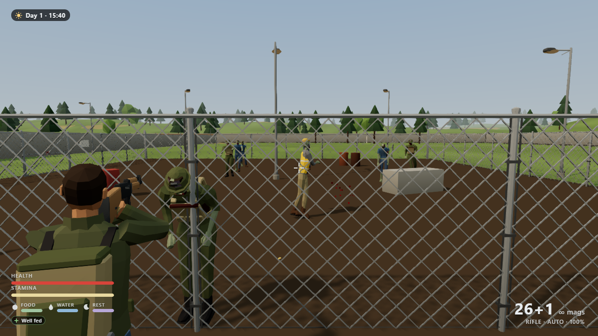
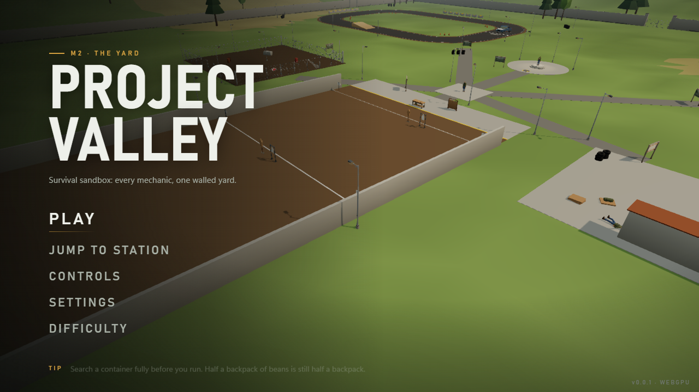
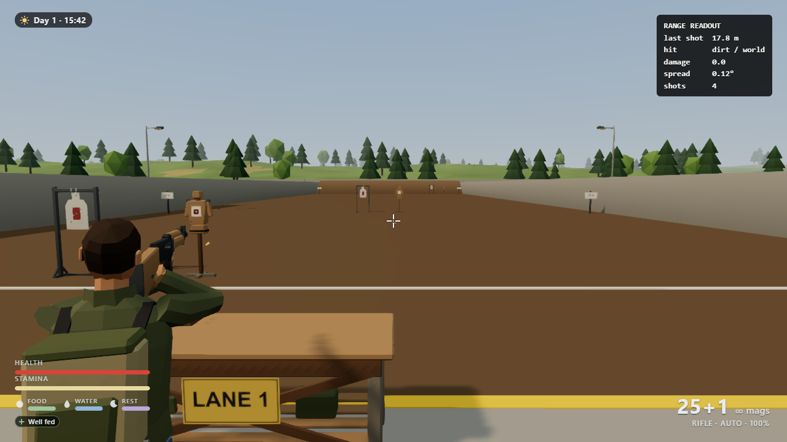
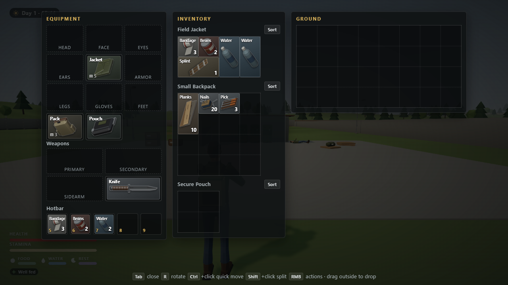

# Project Valley

An open-world zombie survival game that runs in the browser. Built from scratch with three.js
(WebGPU), Rapier physics and TypeScript. No engine, no asset store: every 3D model is generated by a
Blender Python script in this repo.

**Play it: https://project-valley.pages.dev** (Chrome or Edge on a desktop, keyboard and mouse)



## What is in it

The current build is **The Yard**: one walled sandbox with a station for every core mechanic.

- **Combat:** pistol and rifle with recoil, spread, fire modes, magazines and reloads; knife, crowbar and hammer for melee; a shove for when they get close.
- **Zombies:** several archetypes with senses (sight, sound), attack telegraphs and a token system so a crowd takes turns instead of piling on.
- **Loot and inventory:** search containers and bodies, then sort the haul into a grid inventory (jacket, backpack, secure pouch, hotbar).
- **Survival:** health, stamina, food, water and rest, bleeding and medical items, a day clock.
- **Building:** place, rotate and remove wall pieces on a build pad.
- **Vehicles:** a pickup truck you can drive around a track.
- **Lockpicking**, saves, a settings menu, difficulty presets, and a debug and performance overlay.

| | |
|---|---|
|  |  |
|  | |

Inspired by open-world zombie survival games such as SurrounDead.

## Controls

| Key | Action |
|---|---|
| W A S D | Move (drive in a vehicle) |
| Shift / C / Space | Sprint / crouch / jump or vault |
| Mouse | Look |
| Left mouse / Right mouse | Fire / aim |
| R / X | Reload / switch fire mode |
| V | Shove |
| 1 to 4, 5 to 9 | Weapons, hotbar items |
| E (hold) | Interact, search |
| Tab | Inventory |
| B | Build mode (mouse wheel picks a piece, R rotates, X removes) |
| F | Enter or leave a vehicle (Space handbrake, H horn) |
| T / Q | Switch camera / swap shoulder |
| Esc | Pause menu |
| H | Help with every control |
| F1 / F3 | Debug menu / performance stats |

## Run it locally

Needs Node.js 20.19+ or 22.12+ and a browser with WebGPU (Chrome or Edge 113+). Other browsers fall
back to WebGL2 automatically; add `?webgl` to the URL to force that path.

```bash
npm install
npm run dev        # http://localhost:5188
npm test           # unit tests (Vitest)
npm run build      # type check + production build into dist/
npm run preview    # serve the build on http://localhost:5189
```

The dev and preview servers send `Cross-Origin-Opener-Policy` and `Cross-Origin-Embedder-Policy`
headers, and so does the production host (`public/_headers`), so every asset is self-hosted.

## How it is built

- **Rendering:** three.js r186 `WebGPURenderer` with TSL materials, one shared palette texture, LODs, instancing and an FXAA pass.
- **Physics:** Rapier (WASM) for the character controller, colliders and the vehicle.
- **Simulation apart from rendering:** game state is plain data, so saves and future co-op stay possible.
- **Data driven:** every tunable number is in `src/content/data/`, every player-facing string in `src/content/text/`.
- **Assets:** `tools/blender/` builds each model headless in Blender, `tools/build-assets.mjs` optimises the GLBs (meshopt) and writes the manifest.

```
src/
  core/       game loop, events, contracts
  engine/     renderer, physics, audio, assets, input, perf overlay
  gameplay/   player, camera, weapons, zombies, vehicles
  systems/    inventory, survival, building, lockpicking, saves
  world/      the Yard and its stations
  ui/         menus, HUD, inventory screen
  content/    data tables and text
tools/        Blender scripts, asset build, audio import, perf and smoke tests
docs/         game plan, design principles, art bible, research, QA reports
```

The long-form design docs are `GAME_PLAN.md` and `docs/design/`.

## Credits and licence

Code and original art: MIT, see [LICENSE](LICENSE). Animation and audio come from CC BY 4.0 and CC0
sources, credited in [CREDITS.md](CREDITS.md).
